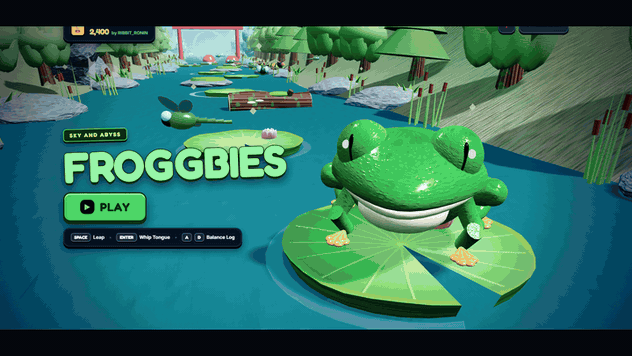

# 🐸 Froggbies: Sky and Abyss

<p align="center">
  
</p>

<p align="center">
  🔊 <em>With soundtrack? Play <strong><code>assets/promo/froggbies-trailer.mp4</code></strong> — same cut, <strong>OceanKing — “Alone, Not Lost”</strong> license-free score.</em>
</p>

<p align="center">
  <em><strong>One frog. Endless rapids. 13 seconds of pure river-runner chaos.</strong></em>
</p>

[](LICENSE)
[](index.html)
[](#-100-procedural-sound)
[](#-100-procedural-no-external-assets)
[](vite.config.js)

**Froggbies: Sky and Abyss** is a high-velocity, tactile 3D procedural arcade river-runner that runs entirely in the browser — no downloads, no installs, no asset files. Leap across roaring canyon rapids, master real-time cedar-log balancing physics, whip a spring-animated grappling tongue to snatch fireflies out of midair, and unleash 5× Fever shockwaves across four shifting seasonal biomes.

---

## 🎬 What's in the trailer

Every second of the GIF above is real gameplay, cut A-to-Z through the complete mechanics loop:

| ⏱ | Beat | Mechanic |
| :--- | :--- | :--- |
| 0:00 | *(home screen)* | The full 3D menu — that frog is a live procedural model |
| 0:01 | **Camera glide** | Countdown-to-dive cinematic burst into the run |
| 0:02 | **Leap the rapids** | Chained `SPACE` leaps with landing splash physics |
| 0:03 | **Cedar Log physics** | Rotational-inertia balancing with `A` / `D` — logs tilt & slide |
| 0:04 | **Springboard Boost** | 🍄 Red mushrooms catapult you **two** pads ahead |
| 0:05 | **Whirlpool Vortex** | 🌀 Lingering past **1.25s** = sucked under. Beat the clock |
| 0:06 | **Biome Gate** | ⛩️ Torii gates award `+500` and shift the entire atmosphere |
| 0:07 | **Four living biomes** | ☀️ Sky & Abyss → 🌧️ Monsoon Storm → ❄️ Alpine Frost → ✨ Firefly Night |
| 0:08 | **Tongue Grapple** | Whip a spring-ribbon 3D tongue (`ENTER` or click a fly) |
| 0:09 | **5× Fever Shockwave** | Chain 5 quick leaps: radial blast sweeps hazards & magnetizes flies |
| 0:10 | *The river wins, sometimes* | Miss a pad — instant splash, instant rematch |
| 0:11 | **Play it now** | See you at the rapids 🐸 |

---

## 📸 Screenshot gallery

| | |
| :---: | :---: |
| **Start Screen** — live 3D hero frog, procedural everything | **Sunny Rapids** — top-down leap action through the roar |
|  |  |
| **Mid-Air Leap** — squash-and-stretch takeoff, motion trails over open water | **Alpine Frost** — cold-cast light, drifting snow |
|  |  |
| **Monsoon Storm** — dark sky, rain streaks, wasp patrols | **Firefly Night** — neon bioluminescence & glowing pads |
|  |  |
| **River Field Guide** — every platform, explained in-game | |
|  | |

---

## 🎮 Gameplay & Technical Highlights

- **Dynamic Procedural 3D Rapids** — infinite forward-scrolling river canyon with real-time vertex-displaced water and foam-edge shading. The terrain is generated code-first: no 3D models, no textures, no files.
- **Physics-Driven Platforms**:
  - 🍃 **Lily Pads** — flat, stable resting surfaces that bob on springs under landing impact.
  - 🪵 **Cedar Logs** — drift laterally with rotational inertia; standing on one means *balancing*. Tap `A`/`D` or the log throws you off.
  - 🍄 **Spring Mushrooms** — high-velocity 2× boost trampolines.
  - 🌀 **Whirlpools** — violent vortexes; a 1.25s timer you can't outrun without leaping.
- **Grappling Tongue Mechanic** — click a flying insect in 3D space or press `ENTER` to whip a spring-animated ribbon tongue with squash-and-stretch jaw animation.
- **5× Combo Fever Shockwaves** — chain quick leaps to charge the fever meter; at 5× an explosive radial shockwave neutralizes hazards and magnetizes collectibles toward your tongue.
- **Four Seasonal Biomes** — real-time atmospheric lighting, fog, water and particle transitions between **Sky & Abyss**, **Monsoon Storm**, **Alpine Frost**, and **Firefly Night** — switchable live with `B` or earned via ⛩️ gates.
- **Difficulty Spiral** — every 100m the river gets angrier: faster sweeping currents, meaner hornet patrols, wider log drift. Up to **Rapids Level 8**.
- **Kinetic Arcade HUD** — diegetic, zero-blur tactile controls, live combo gauge, hearts, season label and a “JUMP NOW!” sink-warning system, all DOM-rendered.

---

## 🕹 Controls Guide

| Action | Keyboard | Mouse / Pointer | Touch (Mobile/Tablet) |
| :--- | :--- | :--- | :--- |
| **Leap Forward** | `SPACE` | Click target platform in 3D | Tap target platform |
| **Grapple Tongue** | `ENTER` | Click flying insect in 3D | Tap flying insect |
| **Log Balance (Left / Right)** | `A` / `D` or `←` / `→` | Click left/right HUD buttons | Tap on-screen tilt buttons |
| **Switch Weather / Season** | `B` | Click 🌦 Weather HUD button | Tap 🌦 Weather HUD button |
| **Mute / Unmute Audio** | `M` | Click 🔊 Mute HUD button | Tap 🔊 Mute HUD button |
| **Pause / Field Guide** | `P` or `ESC` | Click ⏸ Pause HUD button | Tap ⏸ Pause HUD button |

---

## 🚀 Build and Run Instructions

This project is completely buildable and runnable directly from this repository — zero-install direct run or full Vite bundling.

### Prerequisites
- A modern browser with WebGL and Web Audio API support (Chrome, Edge, Firefox, Safari).
- *(Optional, for build tooling)*: [Node.js](https://nodejs.org/) v18+ and `npm`.

### Method 1: Local Development Server (Recommended)

```bash
git clone https://github.com/izigriss/froggbies.git
cd froggbies

npm install
npm run dev
```

Open your browser at **`http://localhost:3000`**

### Method 2: Production Build & Preview

```bash
npm run build
npm run preview
```

The production output is generated in `./dist/index.html` (plus `./dist/froggbies.html`), minified and ready for static / CDN deployment.

### Method 3: Instant Zero-Install Direct Run

No tools required — open the standalone single-file build in any browser:

- **Windows**: `start dist/froggbies.html` (or double-click it)
- **macOS**: `open dist/froggbies.html`
- **Linux**: `xdg-open dist/froggbies.html`

Or serve statically:

```bash
python -m http.server 3000
```

Then visit `http://localhost:3000`.

---

## 🧪 Testing and Integrity Validation

Automated checks verify DOM nodes, CDN dependencies, source files and the standalone build:

```bash
npm test
```

Expected output:

```
--- Running Froggbies Game Repository Integrity Verification ---
PASS: All 28 required HUD/Game DOM elements verified in index.html.
PASS: All external CDN libraries and fonts verified in index.html.
PASS: All 11 modular source files exist and verified.
PASS: dist/froggbies.html verified as intact standalone single-file build.
--- All Verification Tests Passed Successfully! ---
```

---

## 🎞 Promo media

The trailer and screenshots in this README were produced during development from a recorded, scripted elite run of the game (a 100s in-browser gameplay capture, post-edited into a motion-designer cut: retime/slow-mo beats, speed ramps, camera punches, white-flash cuts, letterbox + vignette + per-beat grading, kinetic captions, biome b-roll montage and an animated end card).

Committed media:

- `assets/promo/froggbies-trailer.gif` — hero README trailer (720×405, 30fps, ~13.6s). Silent by GIF format.
- `assets/promo/froggbies-trailer.mp4` — same cut at 1280×720 with the soundtrack: *OceanKing — Alone, Not Lost* (royalty-free, Pixabay license). Highest-energy final-chorus section, loudness-normalized, fade-out landing on the end card. Use this version for judging/sharing.
- `assets/screenshots/*` — README gallery stills.


---

## 📁 Repository Structure

```
froggbies/
├── .github/
│   └── workflows/
│       └── ci.yml             # GitHub Actions CI/CD: test, build, Pages deploy
├── assets/
│   ├── promo/
│   │   ├── froggbies-trailer.gif   # hero README trailer (30fps motion-designer cut)
│   │   └── froggbies-trailer.mp4   # 720p trailer with soundtrack (judging/share)
│   └── screenshots/           # README gallery stills (menu, biomes, action, guide)
├── css/
│   └── style.css              # Tactile arcade HUD styling & animations
├── dist/
│   └── froggbies.html         # Standalone single-file HTML build (zero-install run)
├── scripts/
│   └── validate.js            # Automated integrity & DOM parser test script
├── src/
│   ├── audio.js               # Procedural Web Audio API sound synthesizer (SoundFX)
│   ├── constants.js           # Seasonal biomes, game dimensions & storage helpers
│   ├── game.js                # Core game mechanics, leaps, collisions & river cycle
│   ├── main.js                # Game orchestrator, render loop & event listeners
│   ├── materials.js           # Three.js shared materials & procedural geometries
│   ├── particles.js           # 3D water ripples, splash particles & score popups
│   ├── state.js               # Central game state management
│   ├── textures.js            # Procedural Canvas 2D PBR textures (skin, bark, rocks)
│   ├── ui.js                  # DOM HUD references, scorecard rollup & UI bindings
│   └── entities/
│       ├── environment.js     # Procedural river terrain, pads, logs, hornets & flies
│       └── frog.js            # Procedural 3D frog model, articulated limbs & tongue
├── .gitattributes             # Line-ending normalization rules
├── .gitignore                 # Build artifacts & dependency ignore patterns
├── index.html                 # Clean modular game entry point
├── LICENSE                    # MIT open-source license
├── README.md                  # Comprehensive project documentation (this file)
├── package.json               # Project manifest, dependencies, and build scripts
└── vite.config.js             # Multi-page Vite production bundler configuration
```

---

## 📦 Attribution & Third-Party Notice

- **Libraries**: Three.js (`r128`, MIT) & Tailwind CSS (`3.4.17`, MIT).
- **Fonts**: Fredoka & Inter (Google Fonts, SIL Open Font License 1.1).
- **In-game assets**: 100% procedural in-engine generation — no external 3D models, textures or audio recordings are imported.
- **Genre inspiration**: classic arcade river-crossing mechanics (*Frogger*, *Crossy Road*), developed into an original 3D action runner with dynamic log physics and 5× fever shockwaves.

---

## 🎧 100% Procedural Sound

Every bounce, splash, tongue snap and combo chime is mathematically synthesized at runtime through the browser's native Web Audio API. There are no audio files in this repository — the soundtrack literally is code.

---

## 🤖 AI Disclosure

In compliance with submission guidelines, the following AI tools and coding assistants were utilized:

- **Claude Code** — terminal-based autonomous coding agent for modular architecture refactoring, project restructuring and build pipeline setup.
- **JetBrains AI Assistant / Junie** — in-IDE agentic assistant for code analysis, linting verification and cross-module inspection in WebStorm / IntelliJ IDEA.
- **Gemini** — formulation of procedural Three.js character geometries, log roll rotational physics and Web Audio API synthesizer frequency calculations.

---

## ⚖ License

This project is licensed under the **MIT License**. See the [LICENSE](LICENSE) file for the full license text.

Copyright © 2026 **Naimish Singh**.
